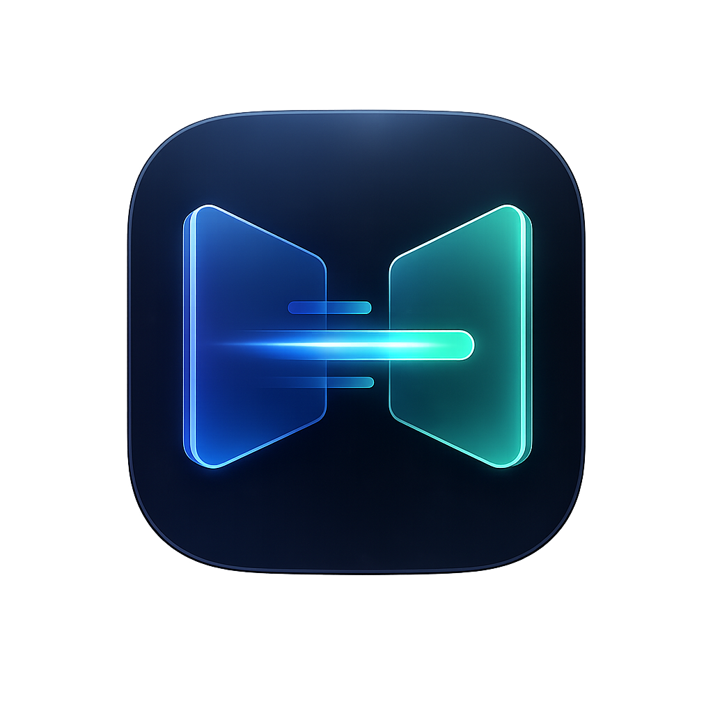

# BlinkSend

BlinkSend 是一个面向 Windows 局域网的点对点文件传输桌面程序。它可以自动发现同一局域网内的设备，支持文件、文件夹、多文件队列、断点续传和传输历史，适合在多台 Windows 电脑之间快速互传素材、压缩包、工程文件和大体积资源。



## 功能特性

- 局域网自动发现设备
- 文件、文件夹、拖拽发送
- 多文件顺序队列，避免同时挤占局域网连接
- 文件夹批次一次确认，接收方不用逐个文件点击
- 大文件传输进度、速度和完成状态显示
- `.part` 临时文件断点续传
- 自定义接收目录，默认 `Downloads\BlinkSend`
- 最近 200 条传输历史
- 兼容旧版 `LAN Share` 发现协议
- Windows 便携版 exe，双击即用
- 启动检查 / 手动检查 GitHub Releases，下载校验后切换新版
- 同名文件可选择替换、保留两份，或整批保存到新目录

## 下载

进入 GitHub Releases 下载 Windows 版本：

- `BlinkSend-Portable-0.3.0.exe`：便携版，双击即用，不需要安装。

## 快速开始

1. 在两台或多台 Windows 电脑上运行 BlinkSend。
2. 确保这些电脑处在同一个局域网内。
3. 如果 Windows 防火墙弹窗，允许 BlinkSend 访问专用网络。
4. 在左侧选择目标设备。
5. 点击“选择文件”或直接拖拽文件/文件夹到主区域。
6. 接收方点击“接收”，文件会保存到设置的接收目录。

## 本地开发

```powershell
git clone https://github.com/bxq9200/blinksend.git
cd blinksend
npm install
npm start
```

## 打包

生成 Windows 便携版：

```powershell
npm run dist
```

生成文件位于：

```text
dist\BlinkSend-Portable-0.3.0.exe
```

## 当前协议

- UDP `43111`：设备发现广播
- TCP `43112`：文件传输，端口占用时会自动选择可用端口并通过 UDP 广播

## 常见问题

### 设备互相看不到

请确认：

- 两台电脑处在同一个局域网。
- Windows 防火墙允许 BlinkSend 访问专用网络。
- 路由器没有开启 AP 隔离或客户端隔离。
- 没有被安全软件拦截 UDP 广播或 TCP 连接。

### 发送文件夹时为什么只确认一次

BlinkSend 会把同一次发送的多文件或文件夹标记为一个批次。接收方对第一个请求点击“接收”或“拒绝”后，同批次后续文件会自动沿用这个决定。

### 断点续传如何工作

接收端在接收目录的 `.blinksend-partials` 中保存临时文件及来源信息。传输中断后，再次从同一设备发送未修改的源文件，并使用相同接收目录和处理方式时，会从已接收的位置继续。“保存到新目录”每次会创建新目录；需要续传时请使用“保留两份”或“替换原文件”。旧版本的旁置 `.part` 文件不会用于新版续传。替换模式在新文件完整接收后才覆盖原文件。

### 同名文件如何处理

接收目录下方可以设置默认处理方式，每次接收请求也可以单独选择。同一个批次后续文件沿用第一次的选择和接收目录。

- 保留两份：同名文件自动加 `(1)`、`(2)` 等后缀，大小不同也不会覆盖。
- 替换原文件：完整接收后替换相同相对路径的文件；中断时原文件保留。
- 保存到新目录：为本次批次创建独立的 `BlinkSend-*` 子目录，保留文件夹层级。不会删除目标目录里未被传输的文件。

### 版本检查和更新

右上角“版本更新”按钮打开检查、下载和切换入口，启动时也会检查正式版。下载包需要通过大小和 SHA-256 校验。网络失败可重试，下载不会自行关闭程序。

便携版会将新版本下载到当前 exe 所在目录，点击“切换新版”并确认后启动新 exe、关闭旧版。旧 exe 保留，配置和历史继续使用原用户数据目录。非便携启动时下载到 `Downloads\BlinkSend-Updates`。有待确认或传输中的任务时不能切换。

`0.2.x` 没有更新入口，需要先手动运行 `0.3.0`，之后可在应用内更新。更新源为 [GitHub Releases](https://github.com/bxq9200/blinksend/releases)。

## Release 流程

1. 修改 `package.json` 和 `package-lock.json` 版本号。
2. 本地验证：

```powershell
npm install
npm run dist
```

3. 提交代码并推送：

```powershell
git add .
git commit -m "Release v0.3.0"
git push
```

4. 创建 tag：

```powershell
git tag v0.3.0
git push origin v0.3.0
```

5. GitHub Actions 会自动构建并上传 Release 产物。

## 技术栈

- Electron
- Node.js UDP/TCP
- 原生 HTML / CSS / JavaScript
- electron-builder

## 安全提醒

BlinkSend 面向可信局域网使用。当前版本没有端到端加密和身份配对，请不要在不可信网络中传输敏感文件。

## License

MIT
